<div align="center">

# 🚴 AdventureWorks — Excel Business Intelligence Dashboard

**A 7-page, interactive BI report built entirely in Microsoft Excel**
Power Query · Data Model · DAX · PivotTables · Slicers · VBA


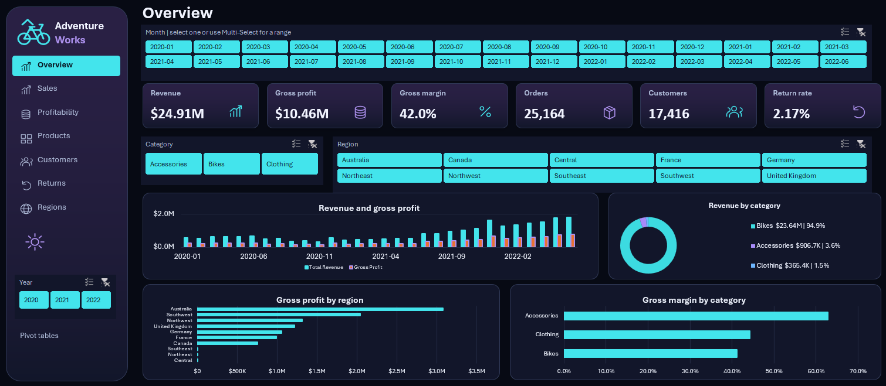

</div>

---

## 📌 Project Overview

AdventureWorks is a fictional bicycle manufacturer and retailer. This project turns its raw sales, returns, customer, product and territory files into a **self-service analytics report inside Excel** — no Power BI licence required.

A business user can open one workbook, filter by **year, month, category and region** with slicers, and move through seven focused dashboards that answer the questions a sales or operations manager actually asks: *How are we growing? Where do we make money? Which products hurt us? Who buys again? Where do returns come from?*

**Data coverage:** January 2020 – June 2022 (2022 is a half-year — see [limitations](#-limitations--data-notes)).

## 🎯 Business Objectives

| # | Question | Dashboard |
|---|----------|-----------|
| 1 | How big is the business and how is it trending? | Overview, Sales |
| 2 | Where does profit come from, and where is margin thin? | Profitability |
| 3 | Which products and sub-categories carry the business? | Products |
| 4 | Who are the customers and how often do they come back? | Customers |
| 5 | How severe are returns, and which products drive them? | Returns |
| 6 | Which markets perform best and which are underdeveloped? | Regions |

## ✨ Project Highlights

- **7 dashboards × 2 themes** — every page ships in **Dark** and **Light** mode with a one-click toggle.
- **Star-schema Data Model** — 2 fact tables + 4 dimensions, built with Power Query and the Excel Data Model (Power Pivot).
- **20+ DAX measures** — revenue, profit, margin, AOV, repeat-customer rate, MoM / YoY growth, return rate and more.
- **Fully interactive** — Year, Month (multi-select range), Category and Region slicers on every page.
- **Animated KPI cards** — a small VBA module gently animates KPI icons on open and stops safely during refresh.
- **Data-quality handling** — malformed customer rows are quarantined in an exceptions table instead of silently dropped; customer e-mail addresses and name prefixes are removed from the model.
- **Built-in recommendations** — an `Insights_Recommendations` sheet turns the numbers into prioritised actions with stated limitations.
- **Everything stays editable** — charts, formulas, PivotTables and slicers are native Excel objects, not images.

## 🖼️ Dashboard Gallery

> Dark mode shown below. Light-mode versions are in the collapsible section at the end of this gallery.

### 1 · Overview
Headline KPIs (Revenue, Gross Profit, Gross Margin, Orders, Customers, Return Rate), monthly revenue vs. profit, revenue mix by category, and gross profit by region.


### 2 · Sales
Revenue trend, month-over-month and year-over-year growth, monthly revenue by category and the top sub-categories.

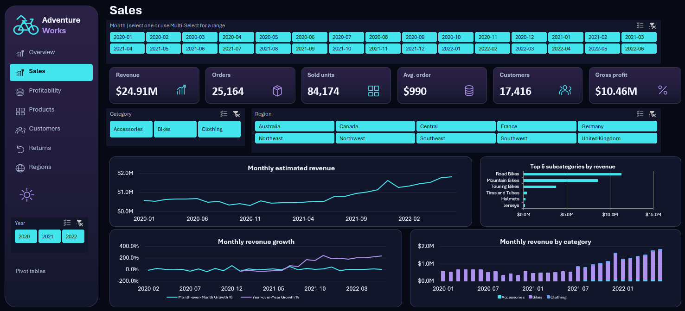

### 3 · Profitability
Revenue → product cost → gross profit bridge, profit by category, margin by region and the lowest-profit products.

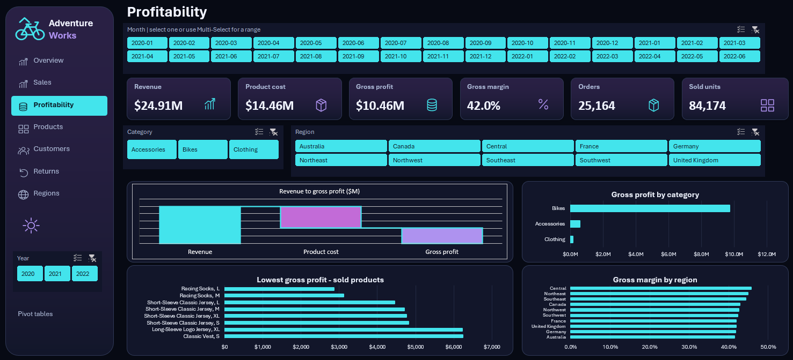

### 4 · Products
Top products by gross profit, sub-category revenue concentration (Pareto), lowest-profit products, and a revenue-vs-margin scatter.

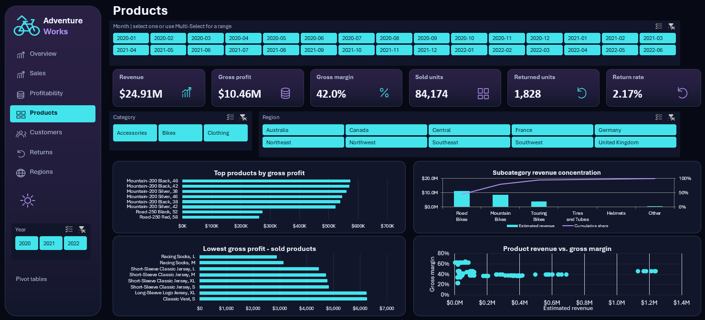

### 5 · Customers
Repeat rate, orders per buyer, revenue per buyer, top customers, and revenue / repeat rate by occupation.

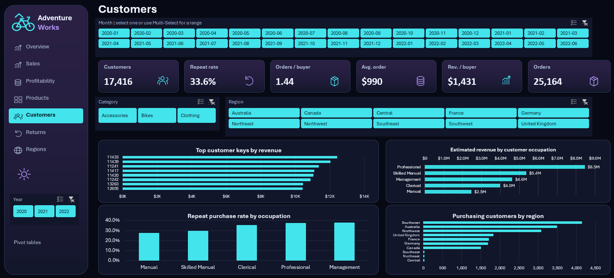

### 6 · Returns
Returned units over time, returns by category, most-returned products and period return rate by category.

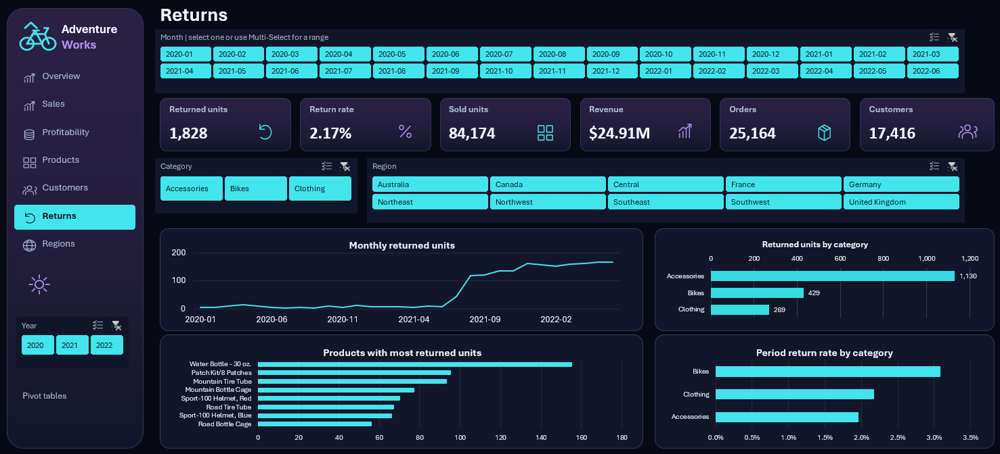

### 7 · Regions
Revenue by country (map), orders by region, gross margin by region and purchasing customers by region.

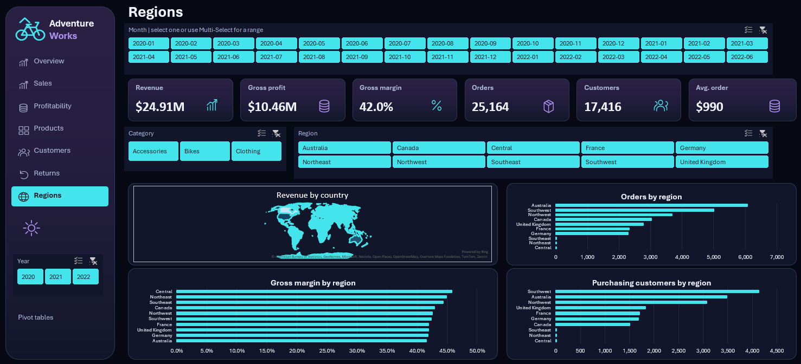

<details>
<summary><b>☀️ Light-mode gallery (click to expand)</b></summary>

<br>

| Overview | Sales |
|:--:|:--:|
| 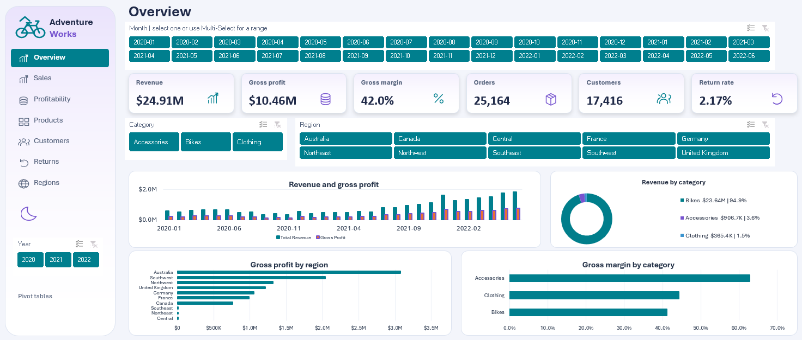 | 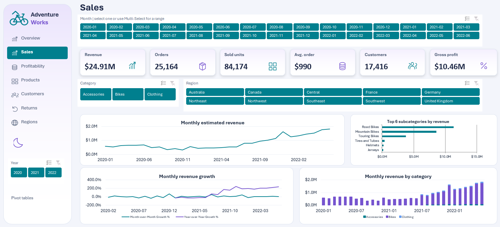 |
| **Profitability** | **Products** |
| 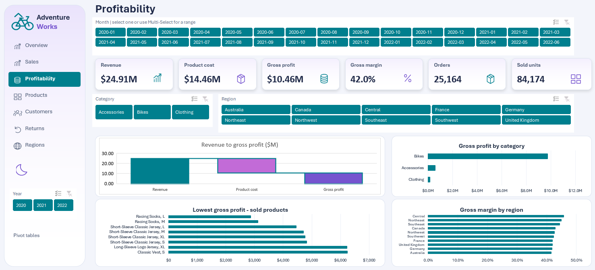 | 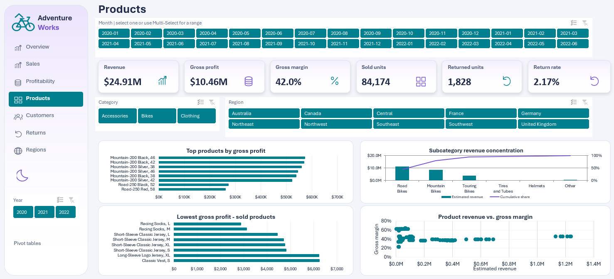 |
| **Customers** | **Returns** |
| 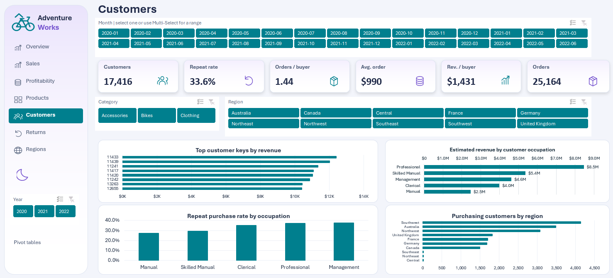 | 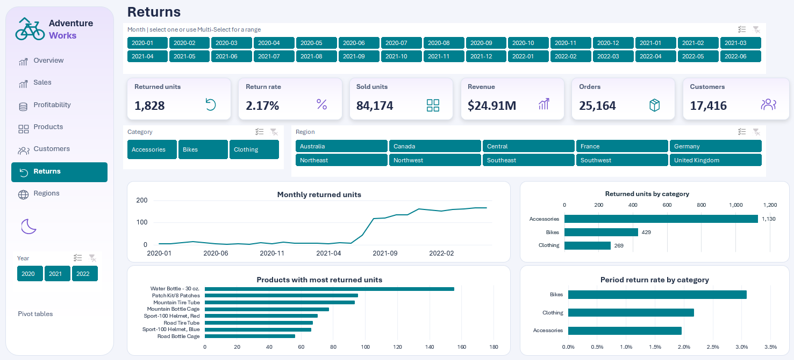 |
| **Regions** | |
| 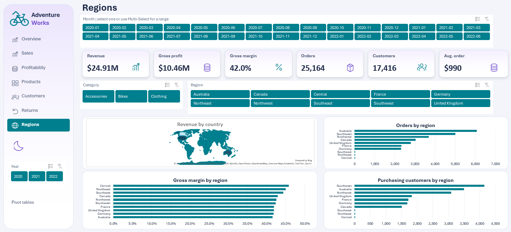 | |

</details>

## 🗂️ Data Model

A star schema: two fact tables (`FactSales`, `FactReturns`) share conformed dimensions (`DimCalendar`, `DimProducts`, `DimTerritories`; `DimCustomers` filters sales).

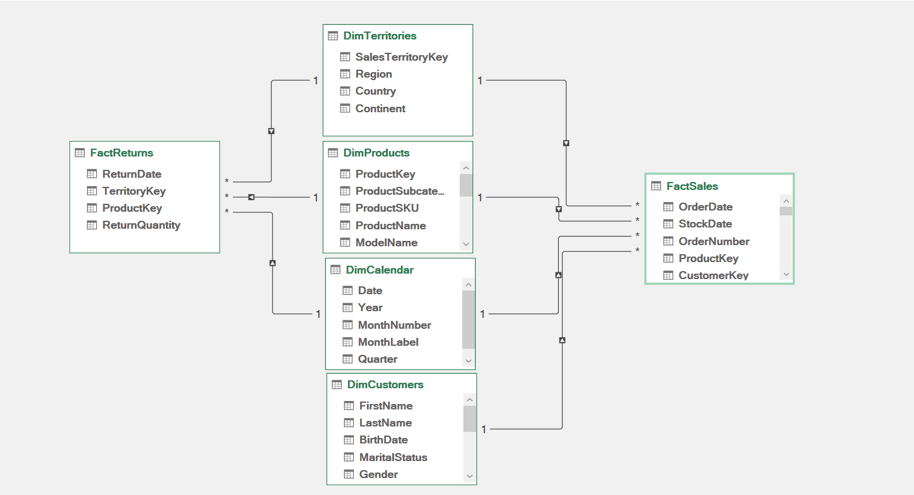

| Table | Type | Grain / purpose |
|---|---|---|
| `FactSales` | Fact | One row per order line — quantity, revenue, product cost |
| `FactReturns` | Fact | One row per return event — date, territory, product, quantity |
| `DimCalendar` | Dimension | Continuous date table with Year, MonthNumber, MonthLabel (`yyyy-MM`), Quarter |
| `DimProducts` | Dimension | Product + sub-category + category, price and cost |
| `DimCustomers` | Dimension | Customer attributes (occupation, income, education …) |
| `DimTerritories` | Dimension | Region, country, continent |

More detail: [`Project_Overview.md`](Project_Overview.md)

## 🛠️ Technical Stack

| Layer | Tooling | What it does here |
|---|---|---|
| ETL | **Power Query (M)** | Loads CSVs, joins product → sub-category → category, types columns, builds the date table, quarantines bad customer rows |
| Modelling | **Excel Data Model / Power Pivot** | Star schema, one-to-many relationships |
| Calculations | **DAX** | KPI and time-intelligence measures |
| Reporting | **PivotTables + PivotCharts** | 7 supporting `PT_` sheets drive the dashboard charts |
| Interactivity | **Slicers** (shared across all 14 pages) | Year, Month, Category, Region |
| UX | **VBA** | KPI icon animation, safe-refresh guard, sheet navigation |
| Design | Custom shapes, icons & two colour themes | Dark / Light dashboards with a sidebar navigation |

## 🎛️ Interactive Features

- **Slicers** — Year, Month (click one, or multi-select a range), Category, Region. Slicers are synchronised across pages.
- **Sidebar navigation** — jump between the seven dashboards; the active page is highlighted.
- **Dark / Light toggle** — the ☀️ / 🌙 icon switches to the same page in the other theme.
- **Animated KPI icons** — start automatically for up to two minutes after opening (macros enabled); click the AdventureWorks logo to replay.
- **Pivot tables link** — every dashboard links to its supporting `PT_` sheet so numbers can be audited.
- **Insights sheet** — prioritised business problems, evidence, proposed actions and expected benefit / limitation.

## ▶️ How to Use

**Requirements:** Microsoft Excel for **Windows** (Microsoft 365 or 2019+) — the Data Model, slicers, macros and the filled-map chart are not fully supported in Excel for Mac or Excel Online / LibreOffice.

1. Download [`AdventureWorks_Excel_BI_Dashboard.xlsm`](AdventureWorks_Excel_BI_Dashboard.xlsm).
2. Right-click the file → **Properties → Unblock** (if present), then open it.
3. Click **Enable Content / Enable Macros** to turn on the KPI animation. The report works without macros — only the animation is disabled.
4. Use the **Year** slicer first, then **Month**, then Category / Region. Clear a slicer with the funnel icon in its top-right corner.
5. Use the sidebar to move between pages, and 🌙 / ☀️ to switch theme.

> ⚠️ **Do not click *Refresh All* unless you have pointed the workbook at your own CSV folder.** The data is already stored inside the Data Model, so the report opens and filters normally. Refreshing needs the original source CSVs — see *Refreshing the data* in [`Dashboard_Guide.md`](Dashboard_Guide.md).

## 💡 Business Insights

Figures below are taken from the dashboards (Jan 2020 – Jun 2022).

**Headline performance:** **$24.91M** revenue · **$10.46M** gross profit · **42.0%** gross margin · **25,164** orders · **17,416** customers · **2.17%** return rate · **$990** average order value.

1. **Revenue is highly concentrated in bikes.** Bikes are **94.9%** of revenue; accessories (3.6%) and clothing (1.5%) are marginal. Road, Mountain and Touring bikes drive almost all of it.
2. **Accessories are the margin engine.** Accessories earn a **62.8%** gross margin versus **41.1%** for bikes — a clear cross-sell opportunity to improve profit mix without needing more bike sales.
3. **Bikes have the highest return rate.** **3.08%** of bike units sold are returned (429 / 13,929), against 2.17% overall. Accessories have the most returned *units* (1,130) but a lower rate (~2.0%) because of their volume.
4. **Returns stepped up sharply in mid-2021.** Monthly returned units jumped from single/low double digits to ~120–170 per month — worth investigating (product quality, policy change or data capture).
5. **Regional scale is very uneven.** Australia leads (≈ $7.4M revenue, $3.1M gross profit), followed by Southwest and Northwest. Central, Northeast and Southeast together have only **33 orders** — too few to treat as reliable market signals.
6. **Retention has headroom.** **33.6%** of purchasers (5,857 of 17,416) bought more than once; buyers average **1.44 orders** and **$1,431** in revenue. Management and Professional occupations show the highest repeat rates.
7. **Low-profit tail.** Racing Socks and several Short-Sleeve Classic Jerseys sit at the bottom of gross profit — candidates for bundling or range review.

The full prioritised list, with proposed actions and limitations, lives on the `Insights_Recommendations` sheet inside the workbook.

## ⚠️ Limitations & Data Notes

- **Revenue is an estimate.** The source has no transaction prices or discounts, so revenue = `OrderQuantity × ProductPrice` (static list price) and cost = `OrderQuantity × ProductCost`. Currency is unspecified.
- **2022 is incomplete** (Jan–Jun). Compare 2021-01…2021-06 with 2022-01…2022-06 using the Month slicer to avoid a false "decline".
- **Return rate** is a flow ratio (returned units ÷ sold units in the same period), not a cohort defect rate. Return reasons and refund amounts are not available.
- **Sparse territories** (Central, Northeast, Southeast) should not be used to infer market potential.
- The `Components` category has products but no sales or returns, so it is hidden by the slicer.

## 📁 Repository Structure

```
AdventureWorks-Excel-BI/
├── README.md
├── LICENSE
├── AdventureWorks_Excel_BI_Dashboard.xlsm     # the full project workbook
├── Project_Overview.md · Dashboard_Guide.md   # documentation
├── Data_Model.png                             # data model diagram
├── *_Dark.png                                 # 7 dark-mode dashboard screenshots
└── *_Light.png                                # 7 light-mode dashboard screenshots
```

## 📜 Data & License

The dataset is the public **AdventureWorks** sample (a fictional company); no real customers or personal data are used. Raw CSV files are **not** included in this repository. Code, workbook and documentation are released under the [MIT License](LICENSE).

## 👤 Author

**Amr Nader** — Data Analyst
🔗 [LinkedIn](https://www.linkedin.com/in/3mr-nader) · 🐙 [GitHub](https://github.com/amr-n-wahba) · ✉️ amr.n3der@gmail.com

If this project is useful, a ⭐ on the repository is appreciated.
